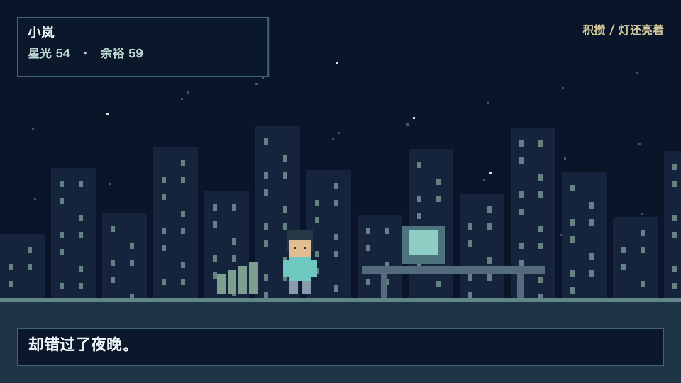

# Pixel Story MV · 像素叙事视频 Skill

用像素人物、游戏界面与数值变化讲一个故事。支持 Agent 制作分镜、角色动画、帧级时间轴、中文字幕、本地混音与 MP4。



## 能做什么

- 同一角色的精灵表、动作标签、变长帧与整数像素缩放。
- 原生 PNG 色板、透明边缘与动画索引检查。
- 音效峰值对拍、音乐压低、淡出、响度测量与最终音轨检查。
- 快速关键帧检查、逐帧渲染、全片解码与可核验报告。

它是制作工作流和可修改模板，不是自动理解任意歌曲、自动生成任意人物动作的一键服务。

## 安装与使用

将整个仓库放入 Agent 的技能目录，或让具备文件和命令权限的 Agent 读取 [SKILL.md](SKILL.md)。例如 Codex：

```bash
git clone https://github.com/lurongjun64-ops/pixel-story-mv.git ~/.codex/skills/pixel-story-mv
```

然后告诉 Agent：

> 用 $pixel-story-mv 做一条关于【主题】的像素叙事短片，完成预览、本地成片和检查。

## 本地运行

需要 Node.js 22+、Playwright Chromium、FFmpeg 与 ffprobe。先安装运行依赖：

```bash
npm install
npx playwright install chromium
npm test
node scripts/pixel-mv.mjs init work/demo
node scripts/pixel-mv.mjs validate work/demo
node scripts/pixel-mv.mjs inspect work/demo
node scripts/pixel-mv.mjs render work/demo
```

修改 `work/demo/episode.json` 与该目录的画面代码来创作新故事。默认没有音乐，导出无声母版；加入可用的本地音乐或音效后才会有音轨。工具路径可用 `PIXEL_FFMPEG`、`PIXEL_FFPROBE`、`PIXEL_CHROMIUM`、`PIXEL_PLAYWRIGHT` 指定。

详细操作见 [工程与时间轴](references/production.md)、[素材与动作](references/art-and-motion.md)、[音效时间轴](references/audio-timeline.md)。参考方案与取舍见 [GitHub 调研](references/github-research.md)。

## 验证与边界

包含 16 项行为测试。已用原创像素素材和本地合成测试音验证导出、解码、音效对齐与音乐压低。技术通过不等于完整人工视听验收，也不代表已经验证所有操作系统。仓库不含第三方歌曲、付费素材或账号配置，不会自动发布视频。

## 许可证与致谢

本仓库代码、文档和原创示例素材使用 [MIT License](LICENSE)。外部音乐、字体与图片各自适用其许可。工作流研究参考了 Remotion 官方技能、pixel-art、pixel-art-animator 和 pixel-brand-video，具体文件及采用范围见调研记录。
